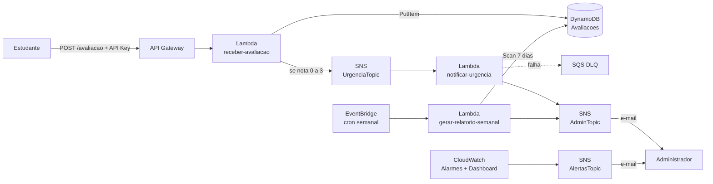
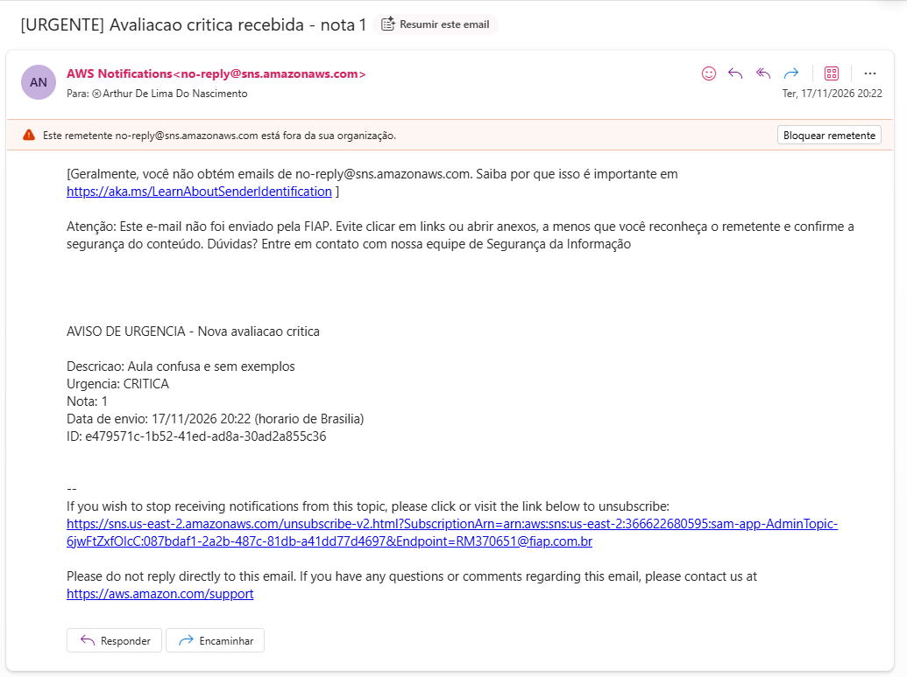
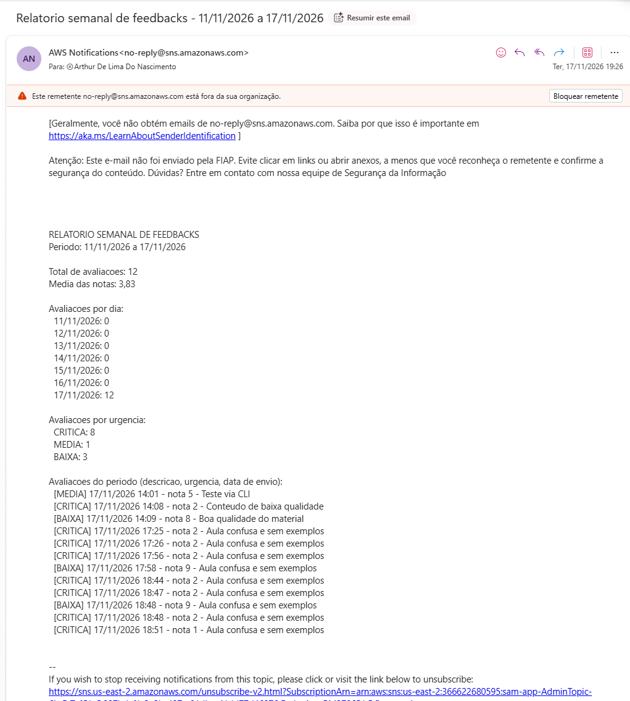

# Plataforma de Feedback - Tech Challenge Fase 4

Aplicação serverless na AWS para receber avaliações de aulas, avisar os administradores sobre avaliações críticas e gerar um relatório semanal. Desenvolvida com **Quarkus (Java 25)**, **AWS Lambda**, **API Gateway**, **DynamoDB**, **SNS** e **EventBridge**, com infraestrutura como código (**AWS SAM**) e deploy automatizado (**GitHub Actions**).

- **Vídeo de demonstração:** [PREENCHER: link]
- **Integrante(s):** Arthur Nascimento - RM370651

## Sumário

1. [Modelo de cloud escolhido](#1-modelo-de-cloud-escolhido)
2. [Arquitetura](#2-arquitetura)
3. [Componentes](#3-componentes)
4. [Funções serverless](#4-funções-serverless)
5. [API](#5-api)
6. [Segurança e governança](#6-segurança-e-governança)
7. [Monitoramento e alertas](#7-monitoramento-e-alertas)
8. [Deploy](#8-deploy)
9. [Testes](#9-testes)
10. [Decisões e limitações](#10-decisões-e-limitações)

## 1. Modelo de cloud escolhido

**Provedor:** AWS, região `us-east-2` (Ohio).
**Modelo:** serverless (FaaS + serviços gerenciados), sem servidores para administrar.

Por que serverless para este problema:

- **Carga irregular:** feedbacks chegam em picos (após as aulas) e o relatório roda uma vez por semana. Com Lambda se paga só pela execução, sem máquina ociosa.
- **Escala automática:** a API suporta picos sem configuração de capacidade.
- **Menos operação:** DynamoDB, SNS, API Gateway e EventBridge são gerenciados, o que reduz a superfície de manutenção e de segurança.
- **Custo:** compatível com o limite de créditos do desafio.

Trade-offs conhecidos: cold start da JVM nas primeiras invocações (mitigado com `TieredStopAtLevel=1` e 1024 MB de memória) e acoplamento ao provedor.

## 2. Arquitetura



Fluxo de uma avaliação crítica: a função 1 valida, grava e publica um evento; a função 2 (assinante do tópico) monta e envia o e-mail. A função 1 nunca envia e-mail, e a função 2 nunca acessa o banco.

## 3. Componentes

| Componente | Serviço AWS | Função na solução |
|---|---|---|
| Entrada HTTP | API Gateway (REST) | Expõe `POST /avaliacao`, exige API Key e aplica throttling (10 req/s, rajada 20) |
| Computação | Lambda (Java 25, Quarkus) | 3 funções com responsabilidade única |
| Banco de dados | DynamoDB | Tabela `Avaliacoes` (chave `id`), criptografia KMS e Point-in-Time Recovery |
| Eventos internos | SNS `UrgenciaTopic` | Desacopla o recebimento da notificação |
| Notificações | SNS `AdminTopic` | Entrega por e-mail os avisos de urgência e o relatório |
| Falhas de entrega | SQS (DLQ) | Guarda avisos que falharam em todas as tentativas |
| Agendamento | EventBridge (Schedule) | Dispara o relatório toda segunda às 08:00 (Brasília) |
| Monitoramento | CloudWatch Logs, Alarmes e Dashboard | Observabilidade e alertas |
| Alertas | SNS `AlertasTopic` | E-mail ao administrador quando um alarme dispara |
| Infraestrutura | AWS SAM / CloudFormation | Toda a infraestrutura em `template.yaml` |
| CI/CD | GitHub Actions | Testa e faz deploy a cada push na `main` |

## 4. Funções serverless

Todas estão no mesmo projeto e no mesmo artefato (`function.zip`). Cada Lambda escolhe qual classe executa pela variável de ambiente `QUARKUS_LAMBDA_HANDLER` (anotação `@Named`). Cada uma tem **role IAM própria** com o mínimo de permissões.

### 4.1 `receber-avaliacao`

| | |
|---|---|
| Classe | `ReceberAvaliacaoHandler` |
| Gatilho | API Gateway `POST /avaliacao` |
| Responsabilidade | Validar o payload, classificar a urgência, gravar no DynamoDB e, se crítica, publicar evento no SNS |
| Entrada | `{"descricao": string, "nota": int 0..10}` |
| Saída | `201` com `id`, `urgencia`, `dataEnvio`; `400` com a lista de erros de validação |
| Permissões | `dynamodb:PutItem` na tabela e `sns:Publish` no `UrgenciaTopic` |

### 4.2 `notificar-urgencia`

| | |
|---|---|
| Classe | `NotificarUrgenciaHandler` |
| Gatilho | Assinatura do `UrgenciaTopic` (SNS) |
| Responsabilidade | Montar e enviar o e-mail de aviso de urgência |
| Conteúdo do e-mail | Descrição, urgência, nota, data de envio (horário de Brasília) e ID |
| Falhas | Lança exceção: o Lambda tenta novamente e, esgotadas as tentativas, envia para a DLQ |
| Permissões | `sns:Publish` no `AdminTopic` (sem acesso ao banco) |

### 4.3 `gerar-relatorio-semanal`

| | |
|---|---|
| Classe | `GerarRelatorioSemanalHandler` |
| Gatilho | EventBridge: `cron(0 11 ? * MON *)` (segunda 11:00 UTC = 08:00 Brasília) |
| Responsabilidade | Consolidar os últimos 7 dias e enviar o relatório |
| Conteúdo | Média das notas, quantidade por dia, quantidade por urgência e lista com descrição, urgência e data de envio |
| Permissões | Somente leitura no DynamoDB e `sns:Publish` no `AdminTopic` |

### 4.4 Regra de urgência

| Nota | Urgência |
|---|---|
| 0 a 3 | `CRITICA` (dispara aviso por e-mail) |
| 4 a 6 | `MEDIA` |
| 7 a 10 | `BAIXA` |

A urgência não vem no payload: é derivada da nota (`Urgencia.fromNota`) e persistida.

## 5. API

**Endpoint:** `POST https://<api-id>.execute-api.us-east-2.amazonaws.com/prod/avaliacao`
**Cabeçalhos:** `x-api-key: <chave>` e `Content-Type: application/json`

Exemplo (o enunciado cita `/avaliação`; na URL usamos `/avaliacao`, sem acento):

```bash
curl -X POST "<ApiUrl>" \
  -H "x-api-key: <chave>" -H "Content-Type: application/json" \
  -d '{"descricao":"Aula confusa e sem exemplos","nota":2}'
```

Resposta `201`:

```json
{"id":"7f1c...","urgencia":"CRITICA","dataEnvio":"2026-11-17T14:20:31.512Z"}
```

Resposta `400` (nota fora da faixa):

```json
{"erros":["nota: nota deve ser no maximo 10"]}
```

| Status | Quando |
|---|---|
| 201 | Avaliação gravada |
| 400 | JSON inválido ou falha de validação |
| 403 | API Key ausente ou inválida |

Exemplo do e-mail de urgência:




Exemplo do e-mail do relatório semanal:



## 6. Segurança e governança

- **Privilégio mínimo:** uma role IAM por função, com políticas restritas ao recurso usado (escrita na tabela só na função 1, leitura só na função 3, publicação apenas nos tópicos necessários).
- **Proteção da API:** API Key obrigatória e Usage Plan com throttling.
- **Validação de entrada:** Bean Validation (`@NotBlank`, `@Min(0)`, `@Max(10)`, `@Size`); entradas inválidas não chegam ao banco.
- **Dados em repouso:** DynamoDB com criptografia KMS e Point-in-Time Recovery; DLQ com criptografia gerenciada.
- **Dados em trânsito:** somente HTTPS.
- **Sem segredos no código:** configurações (nome da tabela, ARNs) por variáveis de ambiente injetadas pelo template; credenciais do pipeline em GitHub Secrets.
- **Governança de acesso:** acesso por usuário IAM individual, sem uso da conta root.
- **Logs estruturados (JSON)** no CloudWatch, com retenção configurada.

## 7. Monitoramento e alertas

Os alarmes do CloudWatch publicam no `AlertasTopic`, que envia e-mail ao administrador.

| Alarme | Condição | O que cobre |
|---|---|---|
| Erros em cada função (3 alarmes) | `Errors >= 1` em 1 min | Falha de qualquer Lambda |
| API 5xx | `5XXError >= 1` em 1 min | Erros do lado do servidor na API |
| Latência `receber-avaliacao` | `p95 > 5000 ms` em 5 min | Lentidão percebida pelo estudante |
| DLQ não vazia | Mensagens visíveis `>= 1` | Aviso de urgência que não foi entregue |

**Dashboard** `<stack>-dashboard` (CloudWatch): invocações, erros e duração p95 por função, e requisições/erros da API. 

Como testar um alarme: invocar `notificar-urgencia` com payload vazio provoca erro e o alarme dispara em poucos minutos:

```bash
aws lambda invoke --function-name <NotificarFunctionName> \
  --cli-binary-format raw-in-base64-out --payload '{}' --region us-east-2 saida.json
```

## 8. Deploy

### 8.1 Pré-requisitos

- Java 25 e Maven 3.9+
- AWS CLI configurada (região `us-east-2`) e AWS SAM CLI
- Conta AWS com permissão para criar os recursos do stack

### 8.2 Deploy manual

```bash
mvn clean package          # gera target/function.zip
sam deploy --guided        # primeira vez: informe o stack e o AdminEmail
sam deploy                 # demais vezes
```

Após o deploy, **confirme as assinaturas de e-mail** enviadas pela AWS (`AdminTopic` e `AlertasTopic`); sem confirmação, nenhum e-mail é entregue.

Parâmetros do template:

| Parâmetro | Descrição | Padrão |
|---|---|---|
| `AdminEmail` | E-mail que recebe avisos, relatório e alarmes | (obrigatório) |
| `CronRelatorio` | Agendamento do relatório (UTC) | `cron(0 11 ? * MON *)` |

Para obter a chave da API:

```bash
aws apigateway get-api-key --api-key <ApiKeyId> --include-value \
  --query value --output text --region us-east-2
```

### 8.3 Deploy automatizado (GitHub Actions)

Arquivo: `.github/workflows/deploy.yml`.

- **Pull Request:** executa build e testes.
- **Push na `main`:** executa build e testes e, se passarem, empacota e roda `sam deploy`.

Secrets necessários: `AWS_ACCESS_KEY_ID`, `AWS_SECRET_ACCESS_KEY`, `ADMIN_EMAIL`.

> **Nota:** o ideal seria autenticar via OIDC com uma role de privilégio mínimo. A criação do provedor OIDC foi bloqueada por uma Service Control Policy da organização AWS, por isso o pipeline usa chaves de acesso em secrets. Migrar para OIDC é uma melhoria futura.

## 9. Testes

```bash
mvn test
```

- Regra de urgência (faixas e valores inválidos)
- Validação do payload
- Handlers das três funções, com repositório e publishers mockados (nenhum teste acessa a AWS)
- Cálculo e formatação do relatório (média, contagem por dia e por urgência, relatório vazio)

## 10. Decisões e limitações

| Decisão | Motivo | Evolução |
|---|---|---|
| Relatório com `Scan` filtrado por data | Volume pequeno; simplicidade | GSI por dia e troca por `Query` |
| E-mails via SNS (assinatura de e-mail) | Evita a sandbox do SES e a verificação de domínio | Migrar para SES com templates HTML |
| Um projeto com três funções | Um artefato e um pipeline, com separação por classe e por role | Um módulo por função |
| JVM com `TieredStopAtLevel=1` | Menor cold start sem build nativo | SnapStart ou build nativo |
| Falha no SNS após gravar a avaliação retorna erro | Simplicidade | Padrão outbox/DynamoDB Streams para garantir a publicação |
| Pipeline com chaves em secrets | SCP da organização bloqueou o OIDC | OIDC com role de privilégio mínimo |

## Estrutura do repositório

```
.
├── pom.xml
├── template.yaml                 # infraestrutura (SAM)
├── .github/workflows/deploy.yml  # CI/CD
└── src
    ├── main/java/br/com/fiap/techchallenge
    │   ├── dto/                  # AvaliacaoRequest
    │   ├── function/             # 3 handlers Lambda
    │   ├── model/                # Avaliacao e Urgencia
    │   ├── publisher/            # publicação no SNS
    │   ├── repository/           # acesso ao DynamoDB
    │   ├── service/              # regras do relatório
    │   └── util/                 # datas
    └── test/java/...
```